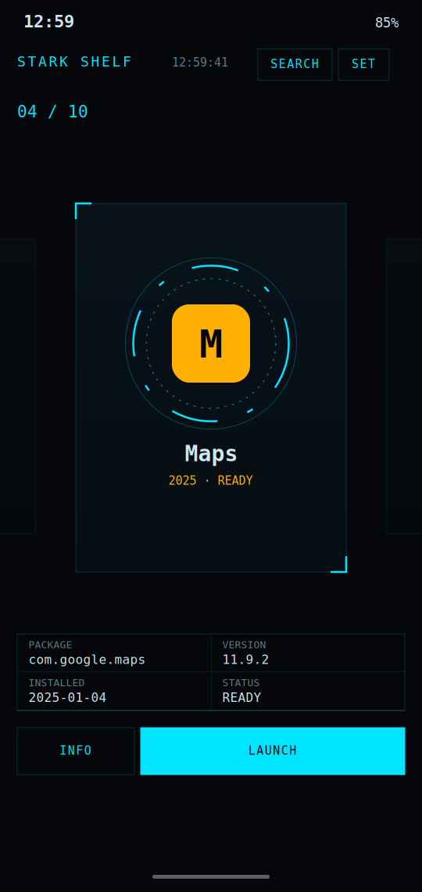
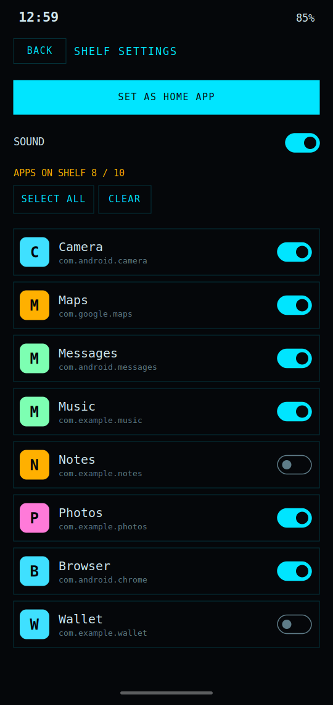

# Stark Shelf

A Stark-style home screen launcher for Android. Your real installed apps sit on a swipeable 3D shelf of glowing HUD cards. Pick which apps appear, launch with a tap, and optionally make it your default home screen.

| Shelf | Settings |
|:--:|:--:|
|  |  |

> **About these images:** they are design previews rendered from the app's layout and colors, with sample app names. They are not captures from a physical device. To replace them, install the app, take real screenshots, and overwrite the two files in `docs/screenshots/`.

---

## Features

- **Real apps, real icons.** The shelf is built from what is installed on your phone, sorted A to Z.
- **3D swipe shelf.** Cards scale, fade and tilt as they move toward the center. The center card shows a rotating HUD ring.
- **Per-app info.** A counter (`04 / 10`) plus package name, version and install date for the centered app.
- **Launch and info.** Tap the centered card or press **LAUNCH** to open the app. **INFO** opens Android's own app details page (uninstall, permissions, storage).
- **Search.** Tap **SEARCH** to filter the shelf by app name.
- **Choose your apps.** The settings page has a toggle for every installed app, plus **Select all** and **Clear**. Your choices are saved.
- **Live updates.** Installing, updating or uninstalling an app updates the shelf automatically.
- **Feedback.** A light haptic tick and a short beep on every card change. Sound can be turned off in settings.
- **Home screen ready.** Declares the Android home intent, so you can set it as your default launcher. Back never closes the shelf.
- **Private.** No internet permission, no accounts, no analytics. Everything stays on your device.

---

## Install it (no Android Studio needed)

GitHub builds the APK for you.

### 1. Put the code on GitHub
1. Create a new empty repository on GitHub (private or public).
2. Push this folder to its `main` branch:
   ```bash
   cd stark-shelf
   git init
   git add .
   git commit -m "Initial commit"
   git branch -M main
   git remote add origin https://github.com/YOUR-USER/stark-shelf.git
   git push -u origin main
   ```
   If you use the website's upload button instead, make sure the hidden `.github` folder is included. Without it, the build will not start.

### 2. Let GitHub build the APK
1. Open the repository's **Actions** tab.
2. The **Build APK** workflow starts on its own after the push. You can also start it with **Run workflow**.
3. The first build takes about 5 minutes. Later builds are faster.
4. When it shows a green tick, the APK is ready.

### 3. Download it on your phone
- Open the repository's **Releases** page in your phone's browser and download `stark-shelf.apk`. Each build creates a new release.
- Alternatively, open the finished workflow run and download the `stark-shelf-apk` artifact (a zip, requires a GitHub login).

### 4. Install
1. Open the downloaded file. Android will ask you to allow installs from your browser (**Install unknown apps**). Allow it for this install.
2. Google Play Protect may show a warning because the app is not from the Play Store and is signed with a debug key. Choose **Install anyway**. You can review the full source in this repository.

### 5. Make it your home screen (optional)
1. Open **Stark Shelf** and tap **SET**.
2. Tap **SET AS HOME APP** and choose **Stark Shelf**.
3. Press your phone's Home button. The shelf is now your home screen.

### Switching back
Open Android **Settings > Apps > Default apps > Home app** and select your previous launcher. Uninstalling Stark Shelf also restores your old launcher.

---

## Using the app

| Action | How |
|---|---|
| Browse apps | Swipe the shelf left or right |
| Launch an app | Tap the centered card, or press **LAUNCH** |
| Jump to a card | Tap a faded side card |
| Search | **SEARCH**, then type; press **SEARCH** again to clear |
| App details / uninstall | **INFO** |
| Choose which apps show | **SET**, then use the toggles |
| Turn sound off | **SET**, then the **SOUND** switch |

---

## How it works

```
Android system
   |  PackageManager.queryIntentActivities (launcher apps)
   v
Data.kt  ShelfVM  ----- DataStore (enabled apps, sound)
   |  StateFlow: all apps / enabled / shown
   v
MainActivity (Compose)
   |-- ShelfScreen    HorizontalPager + HUD cards
   '-- SettingsScreen toggles, home-app shortcut
```

- **App list:** `loadApps()` in `Data.kt` queries every app with a launcher entry, skips Stark Shelf itself, and loads label, icon, version and first install date.
- **Visibility:** the manifest `<queries>` block declares the launcher intent so apps are visible without the restricted `QUERY_ALL_PACKAGES` permission.
- **Live updates:** `ShelfVM` registers a receiver for package added, removed and replaced events and reloads the list.
- **Your selection:** stored in Jetpack DataStore as a set of package names. Until you choose, every app is shown.
- **Shelf visuals:** `HorizontalPager` with side padding so neighbors peek in. Each page reads the pager offset in `graphicsLayer` to scale, fade and rotate itself.
- **HUD ring:** drawn on a `Canvas` with dashed circles rotated by infinite animations (`Ui.kt`).
- **Launcher role:** the second intent filter in `AndroidManifest.xml` (`HOME` + `DEFAULT`) makes Android list it as a home app. `launchMode="singleTask"` keeps a single instance.

---

## Project structure

```
stark-shelf/
|-- .github/workflows/build.yml     CI: builds the APK, publishes a release
|-- app/
|   |-- build.gradle.kts            Android + Compose configuration
|   '-- src/main/
|       |-- AndroidManifest.xml     Home intent, app-visibility query
|       |-- res/                    Theme and launcher icon
|       '-- java/com/stark/shelf/
|           |-- MainActivity.kt     Entry point, screen switching, Back handling
|           |-- ShelfScreen.kt      Shelf, cards, search, meta strip, buttons
|           |-- SettingsScreen.kt   App toggles, home-app shortcut, sound
|           |-- Data.kt             App loading, ViewModel, saved settings
|           |-- Ui.kt               HUD ring, corner brackets, buttons
|           '-- Theme.kt            Color palette
|-- docs/screenshots/               README images
|-- build.gradle.kts, settings.gradle.kts, gradle.properties
'-- README.md
```

---

## Customizing

| Change | Where |
|---|---|
| Colors (cyan, amber, background) | `Theme.kt` |
| Card size and layout | `AppCard` in `ShelfScreen.kt` (`height(340.dp)`) |
| How much neighbors peek in | `contentPadding` in the `HorizontalPager` call |
| Tilt and fade strength | `graphicsLayer` block in `ShelfScreen.kt` |
| HUD ring speed and dash pattern | `Hud` in `Ui.kt` (`18000` and `11000` ms) |
| Beep or haptic | `ToneGenerator` and `performHapticFeedback` in `ShelfScreen.kt` |
| App name and icon | `AndroidManifest.xml`, `res/drawable/ic_launcher.xml` |
| Package id | `applicationId` and `namespace` in `app/build.gradle.kts` |

Change files, commit, push. GitHub builds a new APK each time.

---

## Build locally (optional)

Requirements: Android Studio Koala or newer, JDK 17.

1. Open the folder in Android Studio and let Gradle sync.
2. Press **Run**, or build from a terminal with `gradle assembleDebug` (Gradle 8.9).
3. The APK is written to `app/build/outputs/apk/debug/app-debug.apk`.

---

## Permissions and privacy

- No `INTERNET` permission. The app cannot send data anywhere.
- Reads the list of launchable apps through a narrow `<queries>` declaration.
- Stores only your app selection and sound setting, locally.

---

## Troubleshooting

**The build fails in GitHub Actions.** Open the failed run, click the **Build debug APK** step, and copy the error. Most failures are a typo or a version mismatch and are quick to fix.

**No Actions tab or the workflow does not run.** Confirm `.github/workflows/build.yml` exists in the repo and that you pushed to `main`. Check that Actions are enabled under *Settings > Actions*.

**There is no Release.** Under *Settings > Actions > General > Workflow permissions*, choose **Read and write permissions**, then re-run the workflow. You can still use the run's artifact in the meantime.

**The phone blocks the install.** Allow **Install unknown apps** for the browser or file manager you used. If Play Protect warns, choose **Install anyway**.

**The shelf is empty.** Open **SET** and enable some apps (or press **SELECT ALL**). A fresh install shows every app until you change a toggle.

**Stark Shelf is not offered as a home app.** Open it once first, then try **SET AS HOME APP** again, or use Android *Settings > Apps > Default apps > Home app*.

**I am stuck on the shelf.** Open *Settings > Apps > Default apps > Home app* and pick another launcher. Gesture navigation and recents are handled by Android and keep working.

---

## Roadmap ideas

- Custom card order and pinning favorites
- Text-scramble reveal when the centered card changes
- App categories as filter chips (like the original website)
- Dock for favorite apps, live battery and notification badges
- Release signing and in-app update check

---

## Credits

Visual direction inspired by the Augma Repo "Stark UI" shelf. Built with Kotlin and Jetpack Compose.
